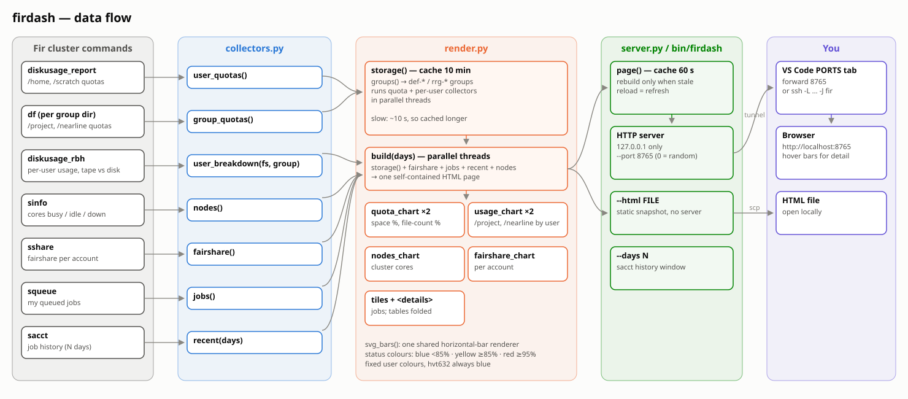

# fir_interface

Dark-theme web dashboard for resource limits on the Alliance **Fir** cluster. Standard library only, so no install is needed.

Pages (sidebar): **Overview**, **Storage**, **Compute**, **Jobs**. Sidebar filters: groups, filesystems, job-history window.

Shows:
- Storage quotas (space + file count) for every def-/rrg- group you belong to, plus /home and /scratch
- /project and /nearline usage per user (tape-only hatched)
- Cluster cores busy/idle by node type, and fairshare per account
- Job tiles; queue and problem-job tables are collapsed

Data comes from `diskusage_report`, `lfs quota` (per-group project ID; `df` misreports /nearline file counts), `diskusage_rbh`, `sinfo`, `squeue`, `sshare` and `sacct`. Storage refreshes every 10 min, everything else every 60 s.

## For lab members

Everyone runs it under their own account and sees their own quotas, jobs and fairshare, plus the per-user
storage of the groups they belong to. Shared copies (read-only, kept in sync by hvt632):

| Your group | Path |
|---|---|
| def-kanj241 | `/project/def-kanj241/hvt632/fir_interface/bin/firdash` |
| def-acilab | `/project/def-acilab/hvt632/tools/fir_interface/bin/firdash` |

From Windows PowerShell (replace `YOURNAME` and use the path for your group; one Duo push, opens in the browser):

```powershell
cmd /c "ssh YOURNAME@fir.alliancecan.ca bash -lc '/project/def-acilab/hvt632/tools/fir_interface/bin/firdash --html -' > %TEMP%\fir.html" ; start $env:TEMP\fir.html
```

On Fir directly: `/project/def-acilab/hvt632/tools/fir_interface/bin/firdash --html ~/fir.html`.

## Usage

```bash
bin/firdash                      # default: private socket ~/.firdash/dash.sock (only you can open it)
bin/firdash --port 8765          # alternative: 127.0.0.1:8765 with a password page
bin/firdash --days 30            # default job-history window
bin/firdash --html report.html   # static snapshot, no server
```

**Snapshot from Windows (no port needed).** One Duo login; Fir builds the page and your browser opens it:

```powershell
cmd /c "ssh hvt632@fir.alliancecan.ca bash -lc '~/bin/firdash --html -' > %TEMP%\fir.html" ; start $env:TEMP\fir.html
```

**Socket mode (default).** No password: the socket file is mode 600, so other users on the login node
cannot connect, and the only way in from your PC is an SSH tunnel, which needs your Duo login:

```bash
ssh -N -L 18765:/home/$USER/.firdash/dash.sock $USER@login1.fir.alliancecan.ca   # use the node it runs on
```

then open http://localhost:18765. Pick any local port Windows allows (8765 can be reserved on Windows/WSL).

**Port mode (`--port`).** Works with the VS Code PORTS tab. The page asks for a password, generated on first
start in `~/.config/firdash/password` (mode 600); edit that file to change it (read at every sign-in) or set
`FIRDASH_PASSWORD` before starting. `/logout` signs out.

Reload the page to refresh (storage is cached 10 min, everything else 60 s).

## Layout



```
bin/firdash            launcher (symlink into ~/bin to put it on PATH)
firdash/collectors.py  runs the cluster commands and parses their output
firdash/charts.py      SVG bar / column charts
firdash/render.py      pages, KPI tiles, layout
firdash/server.py      CLI + HTTP server
```
