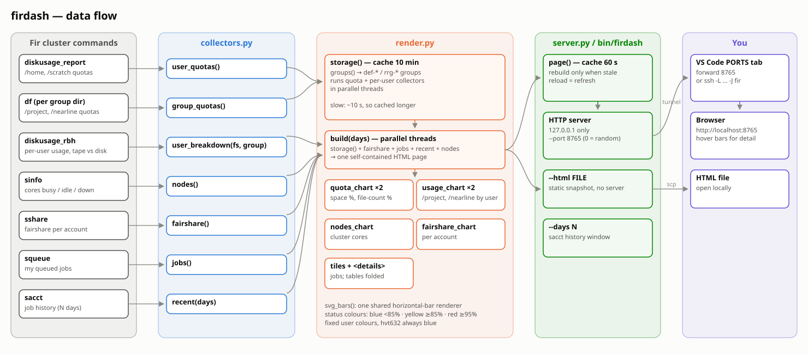

# fir_interface

Dark-theme web dashboard for resource limits on the Alliance **Fir** cluster. Standard library only, so no install is needed.

Pages (sidebar): **Overview**, **Storage**, **Compute**, **Jobs**. Sidebar filters: groups, filesystems, job-history window.

Shows:
- Storage quotas (space + file count) for every def-/rrg- group you belong to, plus /home and /scratch
- /project and /nearline usage per user (tape-only hatched)
- Cluster cores busy/idle by node type, and fairshare per account
- Job tiles; queue and problem-job tables are collapsed
- Whole-filesystem fill (all users): /home + /project + /scratch share one Lustre FS; /nearline disk cache
- Usage trend and "full in N days" forecast per quota (hourly snapshots in `~/.firdash/history.jsonl`; trends appear after a day)
- Array-job progress (completed / running / pending / failed per array)
- Pending jobs with Slurm's expected start time and the reason in plain words
- Job efficiency: peak memory vs requested and CPU efficiency per job name, idle core-hours
- Maintenance windows and reservations

Compute-page banner `docs/h100.jpg`: NVIDIA H100 illustration from
[tatacommunications.com](https://www.tatacommunications.com/knowledge-base/cloud-ai/nvidia-h100-gpu), third-party
image kept for internal lab use only; replace it before sharing the dashboard publicly.

Data comes from `diskusage_report`, `lfs quota` (per-group project ID; `df` misreports /nearline file counts), the nightly robinhood stats behind `diskusage_rbh` (`/project/.stats`, `/nearline/.stats`), `sinfo`, `squeue`, `sshare` and `sacct`. Storage refreshes every 10 min, everything else every 60 s.

## For lab members

Everyone runs it under their own account and sees their own quotas, jobs and fairshare, plus the per-user
storage of the groups they belong to. Currently shared with **def-kanj241** members:
`/project/def-kanj241/hvt632/fir_interface/bin/firdash`.

**Desktop icon (Windows, works on locked-down USask PCs):** right-click the desktop → New → Shortcut, paste
(replace `YOURNAME` with your Fir username), Next, name it "Fir dashboard", Finish:

```
powershell.exe -NoProfile -Command "ssh YOURNAME@fir.alliancecan.ca /project/def-kanj241/hvt632/fir_interface/bin/firdash-html | Out-File -Encoding utf8 $env:TEMP\fir.html; Start-Process $env:TEMP\fir.html"
```

Double-click it, approve the Duo push, and the dashboard opens in the browser (~20 s).

**Web page (no Fir login):** <https://fir.gaig.ca> is a static copy of the dashboard (all groups, all filesystems,
jobs of all members) rebuilt on Fir every hour and pushed to the gaig VM. It opens at once from the USask network or
VPN; from elsewhere it asks for the shared dashboard login (ask Fang or Thuan). How it runs:

- On Fir, `deploy/firdash-push.sbatch` (copied to `~/firdash-push/`) builds the snapshot on a compute node with
  `firdash-html`, pipes it over SSH to the VM, and resubmits itself with `--begin=now+1hour`. The SSH key
  `~/.ssh/gaig-push` is used for nothing else. Stop with `scancel -n firdash-push`; restart with
  `sbatch ~/firdash-push/firdash-push.sbatch`; logs in `~/firdash-push/log/`.
- On the VM, user `firpush` accepts that key with `restrict,command="/usr/local/bin/receive-fir-dash"`
  (`deploy/receive-fir-dash`): the key can only hand over one HTML file, which lands in
  `/var/www/fir-gaig/snapshot/index.html`. nginx (`/etc/nginx/sites-available/fir-redirect`) serves it with the
  USask-network-or-login rule; the login is in `/etc/nginx/fir-guest.htpasswd`.
- The page shows the account that built it (the "Fir <user>" badge) and the build time and node in the sidebar
  footer. /nearline is mounted on login nodes only, so the compute-node build uses the copy of the nightly
  robinhood stats and quota that any login-node run of `firdash` under the same account leaves in
  `~/.firdash/stats/` (the /nearline card says "login-node copy of <date>"). Run `firdash --html /dev/null` on a
  login node now and then to refresh it. Currently built under Fang's account as a trial.

Moving the push to another Fir account (then cancel the old chain with `scancel -n firdash-push` there):

```bash
ssh-keygen -t ed25519 -N '' -f ~/.ssh/gaig-push -C firdash-push   # on Fir, under the new account
cat ~/.ssh/gaig-push.pub        # goes into /home/firpush/.ssh/authorized_keys on the VM, after restrict,command="..."
mkdir -p ~/firdash-push/log && cp /project/def-kanj241/hvt632/fir_interface/deploy/firdash-push.sbatch ~/firdash-push/
sbatch ~/firdash-push/firdash-push.sbatch
```

The earlier fir.gaig.ca landing page (JupyterHub "Open dashboard" buttons, `/open`, `/direct`) was retired on
2026-11-25; `bin/firdash-jupyter-setup` and `jupyter/Fir_dashboard.ipynb` still work inside Fir JupyterHub on their
own but are no longer linked from the web page.

**Windows double-click:** get `windows/Fir-dashboard.cmd`, put it on the desktop and double-click it. It asks for your Fir
username once, then each run is one Duo push and the dashboard opens in the browser.

Or from Windows PowerShell (replace `YOURNAME`; one Duo push, opens in the browser):

```powershell
cmd /c "ssh YOURNAME@fir.alliancecan.ca bash -lc '/project/def-kanj241/hvt632/fir_interface/bin/firdash --html -' > %TEMP%\fir.html" ; start $env:TEMP\fir.html
```

On Fir directly: `/project/def-kanj241/hvt632/fir_interface/bin/firdash --html ~/fir.html`.

## Usage

```bash
bin/firdash                      # default: private socket ~/.firdash/dash.sock (only you can open it)
bin/firdash --port 8765          # alternative: 127.0.0.1:8765 with a password page
bin/firdash --days 30            # default job-history window
bin/firdash --html report.html   # static snapshot, no server
```

**Snapshot from Windows (no port needed).** One Duo login; Fir builds the page and your browser opens it:

```powershell
cmd /c "ssh hvt632@fir.alliancecan.ca bash -lc '~/bin/firdash --html -' > %TEMP%\fir.html" ; start $env:TEMP\fir.html
```

**Socket mode (default).** No password: the socket file is mode 600, so other users on the login node
cannot connect, and the only way in from your PC is an SSH tunnel, which needs your Duo login:

```bash
ssh -N -L 18765:/home/$USER/.firdash/dash.sock $USER@login1.fir.alliancecan.ca   # use the node it runs on
```

then open http://localhost:18765. Pick any local port Windows allows (8765 can be reserved on Windows/WSL).

**Port mode (`--port`).** Works with the VS Code PORTS tab. The page asks for a password, generated on first
start in `~/.config/firdash/password` (mode 600); edit that file to change it (read at every sign-in) or set
`FIRDASH_PASSWORD` before starting. `/logout` signs out.

Reload the page to refresh (storage is cached 10 min, everything else 60 s).

## Layout



```
bin/firdash            launcher (symlink into ~/bin to put it on PATH)
firdash/collectors.py  runs the cluster commands and parses their output
firdash/charts.py      SVG bar / column charts
firdash/render.py      pages, KPI tiles, layout
firdash/server.py      CLI + HTTP server
```
